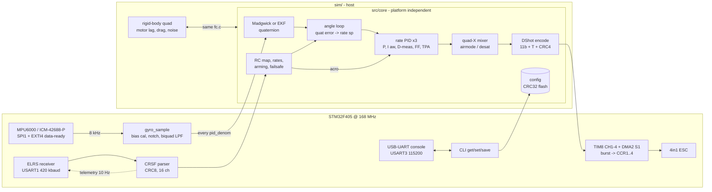
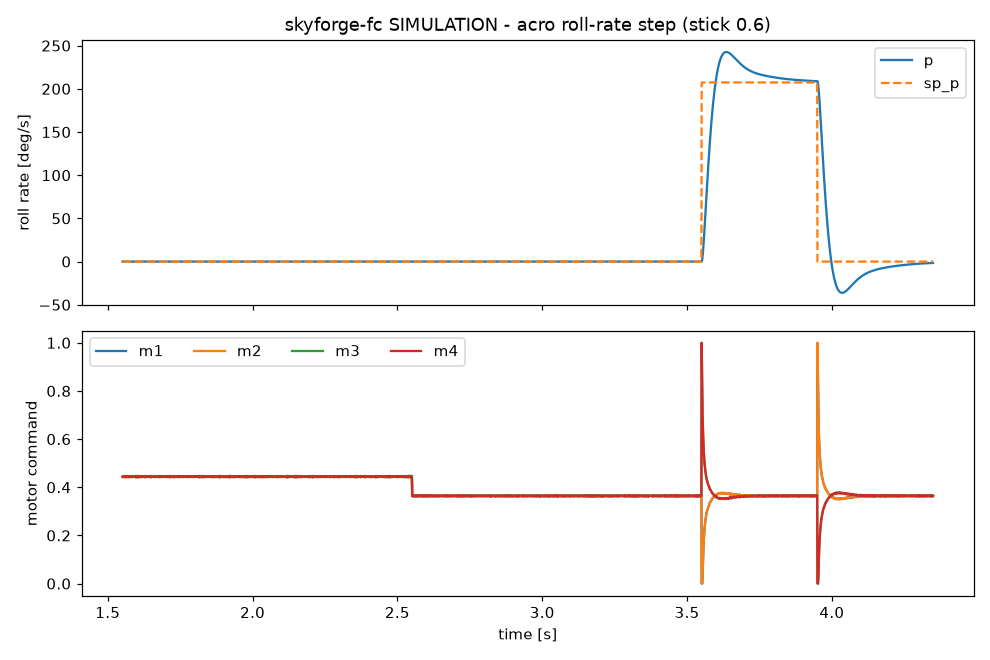
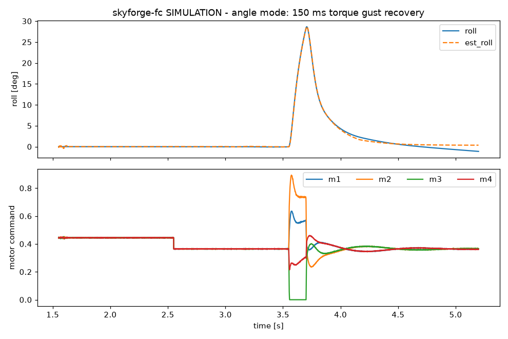
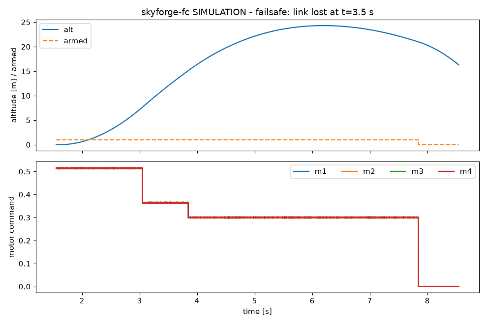

# skyforge-fc

**Bare-metal flight controller firmware for 5" FPV quads, written from scratch for the STM32F405.**
No HAL, no CubeMX, no Betaflight code. The attitude estimators (Madgwick and an
error-state EKF), the cascaded PID loops, the mixer, the DShot encoder and the
CRSF/ExpressLRS parser are all written by hand. The same flight code runs in a
closed-loop rigid-body simulator and in 9 host test binaries.

[](../../actions/workflows/ci.yml)

> ## ⚠️ Safety first: PROPS OFF
> This firmware has **not flown yet** (see [Honest status](#honest-status)). A quad with
> props on can cause serious injury. Do every bench test with the **propellers removed**,
> the quad held down, and a current-limited supply or smoke stopper. Keep the arm switch
> reachable and stay clear of the motors. The first hover should be in a net or a large
> empty space, low and in angle mode, with a failsafe you have already tested.

---

## Contents
- [What's inside](#whats-inside)
- [Architecture](#architecture)
- [How it works](#how-it-works)
- [Build, test, run](#build-test-run)
- [Flashing](#flashing)
- [CLI](#cli-configuration-over-uart)
- [Results (measured on this machine / in simulation)](#results)
- [Hardware validation: TODO for the author](#hardware-validation--todo-for-the-author)
- [Bench test procedure](#bench-test-procedure)
- [Tuning guide](#tuning-guide)
- [Roadmap](#roadmap)
- [Honest status](#honest-status)

## What's inside

| Area | Implementation | Where |
|---|---|---|
| Startup | vector table, Reset_Handler (FPU enable, `.data` copy, `.bss` zero), ROM-DFU jump, linker script | `src/platform/stm32f4/startup.c`, `ld/stm32f405.ld` |
| Clock tree | 168 MHz from 8 MHz HSE via PLL (M=8, N=336, P=2, Q=7), 5 WS flash, HSI fallback | `src/platform/stm32f4/system.c` |
| Time base | SysTick 1 kHz + DWT cycle counter `micros()` | `system.c` |
| Registers | Hand-written minimal register map (RCC, FLASH, PWR, GPIO, SPI, USART, TIM, DMA, EXTI, SYSCFG, NVIC, SCB, DWT) | `src/platform/stm32f4/stm32f4.h` |
| Drivers | GPIO, SPI (mode 3), IRQ-driven UART ring buffers, internal flash erase/program | `src/platform/stm32f4/drivers.c` |
| Gyro | **MPU6000** and **ICM-42688-P** SPI drivers with WHO_AM_I auto-detect, 8 kHz, ±2000 dps, ±8 g, data-ready EXTI, board alignment | `src/drivers/imu.c` |
| Motor output | **DShot150/300/600**: 11-bit throttle + telemetry bit + 4-bit CRC; TIM8 CH1-4 + **DMA burst** (one stream drives all 4 motors); special commands (beep, direction, save) with repeat sequencer; bit-bang BSRR encoder | `src/core/dshot.c`, `src/platform/stm32f4/dshot_tim.c` |
| Receiver | **CRSF/ELRS**: byte-wise parser, CRC-8/DVB-S2, 16×11-bit channels, link statistics, telemetry frames (attitude, flight mode, battery) | `src/core/crsf.c` |
| Filters | RBJ biquad low-pass + notch for gyro, PT1 for D-term / feed-forward / accel | `src/core/filters.c` |
| Estimation | **Madgwick** (beta, boot gain, gyro-only fallback) and a **multiplicative error-state EKF** (6 states: attitude error + gyro bias, Joseph update, chi-square gating), selectable at runtime | `src/core/madgwick.c`, `src/core/ekf_att.c`, `src/core/ahrs.c` |
| Control | angle loop (quaternion error → body rates) → rate PID (D on measurement, feed-forward, conditional-integration anti-windup, TPA); acro and angle modes; rate curves | `src/core/pid.c`, `src/core/fc.c` |
| Mixer | quad-X, Betaflight motor order, airmode + desaturation, props-in/out | `src/core/mixer.c` |
| Safety | arming checks (gyro calibrated, throttle low, level, RX OK, switch edge, CLI/bench), failsafe DROP or LAND→disarm | `src/core/fc.c` |
| Scheduling | gyro-IRQ-clocked 8 kHz loop, PID at 1/2/4/8 kHz (`pid_loop_hz`), cooperative background tasks, loop statistics | `src/core/sched.c`, `src/app/main.c` |
| Config | 55 parameters, `get/set/dump/save/defaults` CLI over UART, CRC32-protected blob in flash sector 11 | `src/core/config.c`, `src/core/cli.c` |
| Boards | board abstraction (`src/boards/board.h`); `f405_generic` implemented, F722/H743 slots | `src/boards/` |
| Simulator | 6-DOF quad model (motor lag, thrust ∝ ω², yaw reaction torque, drag, gyro bias/noise, ground) that runs the real `fc.c`; C CLI + Python ctypes + plots | `sim/` |

Everything in `src/core` and `src/drivers` is platform-independent C11 with no libc.
It also builds for the host (`-DFC_HOST`), which is how it is unit-tested. The
firmware links with `-nostdlib`. The only runtime it carries is the four memory
routines in `libc_min.c`.

## Architecture



Real-time path, per gyro sample (125 µs at 8 kHz):

```
EXTI4 (data ready) -> flag -> main loop: SPI read 14 B -> fc_gyro_sample()
      every pid_denom samples: fc_pid_step() -> fc_motor_dshot() -> dshot_encode() -> DMA start
background (between samples): CRSF bytes -> parser | CLI chars | telemetry 10 Hz | LED 20 Hz
```

## How it works

The full derivations are in [`docs/estimation_and_control.md`](docs/estimation_and_control.md)
and [`docs/protocols.md`](docs/protocols.md). The short version:

**Frames.** World NED, body FRD, `q` rotates body to world. Accelerometers measure specific
force, so the down direction in the body frame is `v = -a/|a|`.

**Madgwick.** One gradient-descent step per sample on `f(q) = Rᵀe₃ − v`:
`q̇ = ½ q ⊗ [0, ω] − β ∇f/|∇f|`, with the 3×4 Jacobian derived by hand for this frame
convention. The accelerometer is skipped (gyro-only integration) when `|a|` is more than
0.25 g away from 1 g, or when the body rate is above 57°/s.

**EKF.** Error state `[δθ, δb]`, `q_true = q ⊗ exp(δθ)`.
Predict: `Φ = [[I − [ω]× dt, −I dt], [0, I]]`.
Measure: `h = Rᵀe₃`, `H = [[h]×, 0]`.
The update uses the Joseph form, a chi-square innovation gate and inflated `R` under
acceleration. The error state is folded back into `q` and `b` after each update. The
filter estimates the gyro bias online, which Madgwick cannot do.

**DShot.** `packet = (value<<1 | T)<<4 | ((v ^ v>>4 ^ v>>8) & 0xF)`. Bits are 37.5 % / 75 %
duty at 1.667 µs (DShot600: CCR 105/210 of 280 ticks at 168 MHz). TIM8 raises a DMA
request on every update. The DMA *burst* mode (`DCR`: base CCR1, 4 transfers) writes one
bit for all four motors per request through `DMAR`.

**CRSF.** `[0xC8][len][type][payload][crc8]`, CRC-8/DVB-S2 (poly 0xD5) over type and
payload. The RC payload is 16 × 11-bit channels packed LSB first; 172/992/1811 map to
988/1500/2012 µs. The parser resynchronises after a 1.5 ms inter-byte gap.

**Control.**
1. Angle mode builds `q_des` from the stick roll/pitch and the current yaw.
2. It computes `q_e = q⁻¹ ⊗ q_des` and sets the body rate setpoint to `angle_p · rotvec(q_e)`.
   Yaw is always rate-controlled.
3. The rate PID runs per axis with D on the measurement, so a setpoint step gives no
   derivative kick, and PT1-smoothed feed-forward.
4. The I-term is frozen while the mixer saturates, unless the error would unwind it, and
   it is clamped to `i_limit`.
5. TPA reduces P and D above a throttle breakpoint.
6. The mixer scales roll/pitch/yaw down uniformly when they don't fit in the motor range.
   With airmode it then shifts the throttle so authority is kept at 0 % and 100 % throttle.

## Build, test, run

### Windows / anywhere with Python (no make, no gcc needed)

```bash
pip install ziglang pytest          # zig ships clang + lld, also cross-compiles to ARM
python tools/build.py test          # 9 C test binaries (host, -Werror)
python tools/build.py sim           # simulator DLL/.so + sim_main
python -m pytest tests/test_sim_py.py
python tools/build.py firmware      # build/fw/skyforge-f405.elf + .bin (thumb, Cortex-M4F hard-float)
```

### Linux / macOS with make

```bash
make test            # host unit tests with $(CC)
make sim-test        # shared library + pytest via ctypes
make firmware        # arm-none-eabi-gcc  (apt install gcc-arm-none-eabi)
```

### Simulator

```bash
./build/host/sim_main step                       # acro roll-rate step, prints t90/overshoot
./build/host/sim_main gust ahrs_type=1           # angle-mode gust recovery with the EKF
./build/host/sim_main step p_roll=70 d_roll=60 --csv > step.csv
python sim/run_sim.py gust --plot gust.png       # needs matplotlib
python examples/tune_sweep.py                    # P/D grid search (simulation only)
```

## Flashing

The binary is a plain image for `0x08000000`. The config sector (sector 11,
`0x080E0000`) is not part of the image, so flashing keeps your saved settings.

**USB DFU (ROM bootloader).** Hold BOOT while plugging in USB, or type `bl` in the CLI.
Then run:
```bash
dfu-util -a 0 -s 0x08000000:leave -D build/fw/skyforge-f405.bin
# or: make flash-dfu
```
> This firmware has no USB stack. The CLI is on USART3 (PB10/PB11), so you need a
> USB-UART adapter for the console. DFU still works because it is the ROM bootloader.

**ST-Link + OpenOCD (SWD pads).**
```bash
openocd -f interface/stlink.cfg -f target/stm32f4x.cfg \
        -c "program build/fw/skyforge-f405.elf verify reset exit"
# or: make flash-stlink
```

**Before flashing a real board,** check the pin map at the top of
`src/boards/f405_generic/board.c` against the board's schematic. It is modelled on common
F405 boards, but pinouts differ between vendors (gyro CS/INT, motor timer, UARTs, LED).

## CLI (configuration over UART)

Connect at 115200 8N1 to the console UART and send `#`. Arming is blocked while the CLI
is active.

```
help | status | get [prefix] | set <name> <value> | dump | save | defaults
motor <1-4|all> <0-0.5>     # 2 s bench spin, disarmed only. PROPS OFF
dshot <1-47> [1-4|all]      # e.g. dshot 21 3 = reverse motor 3, dshot 12 = save in ESC
reboot | bl | exit
```

`set` changes take effect immediately. `save` writes a CRC32-protected blob to flash
sector 11, reads it back and verifies it. Lines starting with `#` are comments, so
[`examples/bench_setup.cli`](examples/bench_setup.cli) can be pasted as is.

## Results

All numbers below were **measured on the development machine (Windows 10, x86-64) or in the
simulator**. None come from a real quad.

### Unit tests (host, `python tools/build.py test`, zig cc 0.17.1)

| Binary | Covers | Tests / checks | Result |
|---|---|---|---|
| test_math | freestanding sin/cos/atan2/asin vs libm (< 2e-6), quaternion/Euler/rotvec | 4 / 2500 | pass |
| test_filters | PT1 time constant, biquad −3 dB point, notch depth, sine response | 3 / 16 | pass |
| test_dshot | reference vectors (e.g. 1046 → 0x82C6), all 4096 encodings round-trip, every 1-bit error detected, 168 MHz timing 280/105/210, DMA buffer layout, bit-bang slots, command repeats | 6 / 4215 | pass |
| test_crsf | CRC-8/DVB-S2 check value 0xBC, known RC frame bytes, garbage/CRC-error/timeout recovery, link stats, telemetry builders | 5 / 100 | pass |
| test_ahrs | Madgwick convergence from 35° error and while rotating; gyro-only fallback; EKF convergence + observable bias; EKF vs Madgwick with uncalibrated bias | 6 / 1054 | pass |
| test_control | P/I/D/FF terms, no D-kick, anti-windup, TPA, PID step on a lagged plant, rate curve, angle controller, mixer signs, desaturation, airmode | 9 / 250 | pass |
| test_imu | MPU6000/ICM-42688-P against a register-level SPI mock: detect, init sequence, scaling, alignment | 4 / 59 | pass |
| test_fc | loop rates, arming checks, switch-on-at-boot, not-level block, failsafe LAND/DROP and recovery, motor outputs, bench timeout, CRSF mapping, flash config + CRC32, CLI, fmt, scheduler | 12 / 160 | pass |
| test_sim | closed loop: gust recovery (both estimators), angle tracking, acro step, failsafe landing, airmode at zero throttle | 6 / 35 | pass |
| `pytest tests/test_sim_py.py` | ctypes-driven sim: stabilise from a disturbed attitude (Madgwick + EKF), param validation, disarmed motors stay off | 4 | pass |

### Closed-loop simulation (default gains, generic 650 g 5" model, gyro 8 kHz / PID 4 kHz)

| Scenario | Metric | Simulated result |
|---|---|---|
| Acro roll-rate step to 207 °/s (stick 0.6) | t90 (incl. up to 4 ms RC latency) / overshoot | 40.6 ms / 17.0 % |
| Angle mode, 0.6 N·m + 0.25 N·m gust for 150 ms | peak roll → roll 1 s after the gust (Madgwick / EKF) | 28.6° → −0.02° / 29.3° → 1.81° |
| Angle mode, roll stick 0.5 (setpoint 27.5°) | roll after 0.6 s | 26.9° |
| Zero throttle, full roll stick (airmode) | achieved / commanded roll rate | 657 / 670 °/s |
| Link loss in hover (LAND, 3 s) | levelled (max tilt < 5°), disarmed after land time, no re-arm with switch on | pass |
| Estimator error during the acro step | max |true − estimated roll| | 0.37° |





The gust plot shows a slow ~1° residual after recovery. That residual is real
simulator physics, not a bug in the plot. After the gust the quad keeps a sideways
velocity, and its drag shows up in the accelerometer as a tilted "gravity" vector. See the
estimator notes in the docs.

### Firmware image (zig cc 0.17.1, `-O2`, Cortex-M4F hard-float)

| | |
|---|---|
| flash | 42.5 KB (4.6 % of the 896 KiB application area) |
| static RAM | 11.7 KB incl. 8 KiB reserved stack (8.9 % of 128 KiB) |
| vector table check | SP = 0x20020000, Reset_Handler and all IRQ vectors in flash with the Thumb bit set |

## Hardware validation / TODO for the author

**Nothing in this section has been done yet.** These are the steps, with the exact commands
and empty tables to fill in. Please don't fill them from the simulator.

1. **Boot and clocks.** Flash, open the console (`screen /dev/ttyUSB0 115200`), check the
   boot banner for `HSE 8 MHz, 168 MHz`. Check SysTick against a stopwatch.
2. **IMU detect.** The banner should show `imu: MPU6000` or `imu: ICM-42688-P`. Run `#` and
   `status`, tilt the board and check the roll/pitch signs (right side down = +roll,
   nose up = +pitch).
3. **Loop timing.** Run `status` at `pid_loop_hz` 1000/2000/4000/8000 with each AHRS.
4. **Receiver.** Bind ELRS, move the sticks, check `status` (mode, arming flags), then turn
   the TX off and check `RX_LOSS`.
5. **DShot on a scope / logic analyser,** with no ESC connected: one frame should show bit
   time 1.667 µs, 0 = 625 ns high, 1 = 1250 ns high, and 4 channels in sync.
6. **ESC bench, PROPS OFF:** `motor 1 0.05` … `motor 4 0.05`, check the order and direction
   against the mixer diagram, and use `dshot 21 n` + `dshot 12 n` where needed.
7. **Failsafe bench, PROPS OFF:** arm, add throttle, switch the TX off. The quad should
   level and hold `fs_throttle`, then disarm after `fs_land_time_s`.
8. **First hover** in angle mode, then acro.

| Check | Expected | Measured |
|---|---|---|
| Boot banner clock source | HSE 8 MHz, 168 MHz | |
| IMU detected | MPU6000 / ICM-42688-P | |
| Avg / max loop period @ 8 kHz gyro | 125 µs / < 187 µs | |
| Overruns per minute, PID 4 kHz, Madgwick | 0 | |
| Overruns per minute, PID 4 kHz, EKF | 0 | |
| Max usable `pid_loop_hz` with EKF | 8000? | |
| DShot600 bit time (scope) | 1.667 µs | |
| DShot '0' / '1' high time | 625 / 1250 ns | |
| CRSF frames OK / CRC errors after 5 min | > 0 / 0 | |
| Failsafe trigger delay after TX off | ≈ 300 ms | |
| Flash `save` survives power cycle | yes | |

Flight log slots:

<!-- video here: first hover (angle mode) -->

<!-- video here: acro flight -->

<!-- blackbox plots here: gyro vs setpoint (roll/pitch/yaw), motor outputs, PID terms -->

| Flight | Battery / props | Mode | Duration | Notes |
|---|---|---|---|---|
| | | | | |

## Bench test procedure

1. **Props off.** Use a smoke stopper or a current-limited bench supply for the first power-up.
2. Power over USB-UART only (no battery). Check the boot banner, `status` and the IMU
   orientation.
3. Plug in the battery through the smoke stopper. The ESCs should play their arming tones,
   because the FC sends continuous `MOTOR_STOP` frames. The DShot frames are clocked by
   the gyro interrupt, so no IMU means no frames and no ESC arming.
4. `motor N 0.05` for each motor. Check which motor spins and its direction against the
   diagram (props-in: 1 & 4 CW, 2 & 3 CCW, seen from above). Fix the direction with
   `dshot 21 N` (reversed) or `dshot 20 N` (normal), then `dshot 12 N` (save in the ESC).
5. `exit` the CLI. Arm with the throttle low: the motors spin at idle (`motor_idle`, 5.5 %).
   Tilt the quad by hand. In acro mode the motors on the low side should speed up and
   resist the rotation.
6. Failsafe test (step 7 above). Disarm test: arm switch off → the motors stop
   immediately.
7. Only then fit the props, and do the first hover outdoors or in a net.

## Tuning guide

The defaults were tuned **in the simulator only** (P 55/58/50, I 50/52/60, D 45/48/0,
F 100/105/90). They are a starting point for a 5" quad. Expect to retune on the real one.

1. **Filters first.** If the motors come down hot, lower `gyro_lpf_hz` (200 → 150) and
   `dterm_lpf_hz` (100 → 80). If a blackbox spectrum shows a frame resonance, set
   `gyro_notch_hz` / `gyro_notch_cutoff_hz` (e.g. 250 / 180).
2. **D.** Raise it until propwash and bounce-back are controlled, but keep motor
   temperature down.
3. **P.** Raise it until you see fast oscillation on hard stops, then back off 10-15 %.
4. **I.** Raise it if the attitude drifts in wind or during throttle punches, or for
   better tracking in arcs. Lower it if you see slow wobbles after flips.
5. **F.** Higher gives a sharper stick response. Lower it if moves overshoot.
6. **TPA.** If oscillation shows only at high throttle, raise `tpa_rate` or lower
   `tpa_breakpoint`.
7. **Angle mode.** `angle_p` sets how hard it self-levels (default 6). Raise it for a
   crisper feel, lower it if it wobbles while levelling.
8. **Loop rate.** Start with `pid_loop_hz 4000`. Drop to 2000 if `status` reports
   overruns (especially with `ahrs_type 1`).

`examples/tune_sweep.py` shows what P and D do to the step response in the simulator.

## Roadmap

- [ ] Bidirectional DShot (GCR eRPM decode) → RPM-harmonic notch filters
- [ ] Dynamic notch from an on-board FFT of the gyro
- [ ] Blackbox logging to on-board flash (SPI NOR) + a host-side decoder/plotter
- [ ] Battery voltage/current ADC → CRSF battery telemetry, low-voltage warning
- [ ] GPIO bit-bang DShot driver (the encoder exists) for boards with scattered motor pins
- [ ] USB CDC console (currently UART only)
- [ ] Independent watchdog; DMA-driven SPI to free CPU time
- [ ] Rotor-drag-aware attitude estimation (removes the post-manoeuvre accel bias)
- [ ] `src/platform/stm32f7` + `boards/f722_*`, `src/platform/stm32h7` + `boards/h743_*`
- [ ] Throttle linearisation / thrust curve, RC smoothing, iterm-relax

## Honest status

| Claim | Status |
|---|---|
| Core flight code (math, filters, estimators, PID, mixer, protocols, arming, failsafe, CLI, config) | implemented; unit-tested on the host; all tests pass |
| IMU drivers | tested against a register-level **mock**, not real silicon |
| Closed-loop behaviour | verified in the **simulator only** (idealised motors, no prop wash, no frame resonance) |
| Firmware build | cross-compiles with zig cc (Cortex-M4F, `-nostdlib`) to `.elf`/`.bin`; image layout checked |
| arm-none-eabi-gcc Makefile and gcc host build | written for CI (`.github/workflows/ci.yml`), **not run on the dev machine** (no gcc/make installed there) |
| Register-level drivers (clock, SPI, UART, TIM8+DMA, flash, EXTI) | written against RM0090, **never run on hardware** |
| Flight | **has not flown.** See the hardware TODO list above |

## Repository layout

```
src/core/        platform-independent flight code (C11, no libc)
src/drivers/     IMU drivers over an abstract SPI bus
src/platform/    MCU layer: stm32f4 registers, startup, clocks, drivers, DShot DMA
src/boards/      board abstraction + f405_generic pin map
src/app/main.c   firmware main loop
ld/              linker script
sim/             rigid-body simulator, CLI, ctypes bindings, plotting
tests/           C unit tests (tinytest.h) + pytest
tools/           build.py (zig cc driver), reference-vector generator
docs/            protocol + estimation/control write-ups, sim plots
examples/        CLI bench script, simulator tuning sweep
```

## License

MIT, see [LICENSE](LICENSE).
